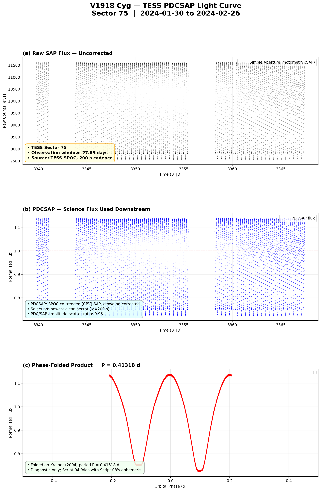
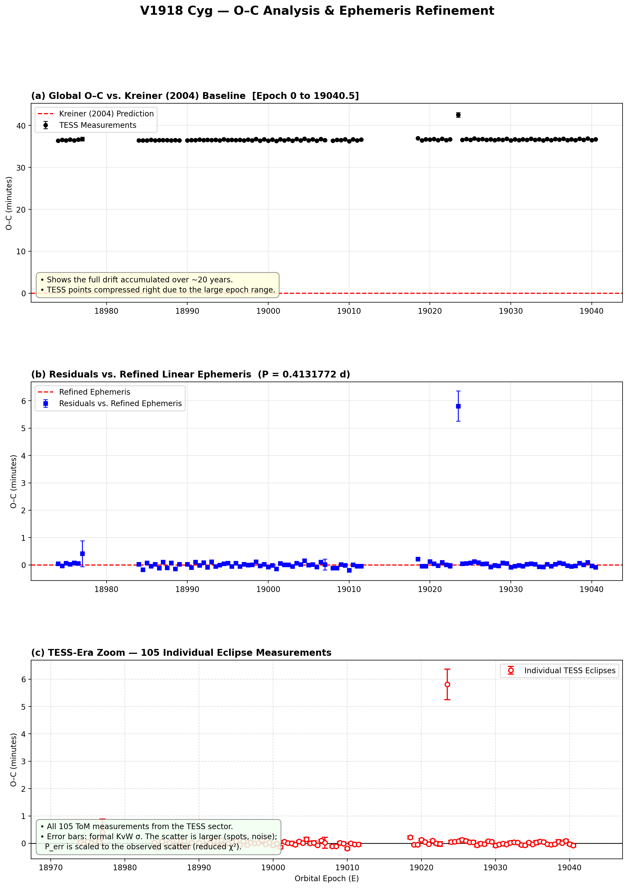
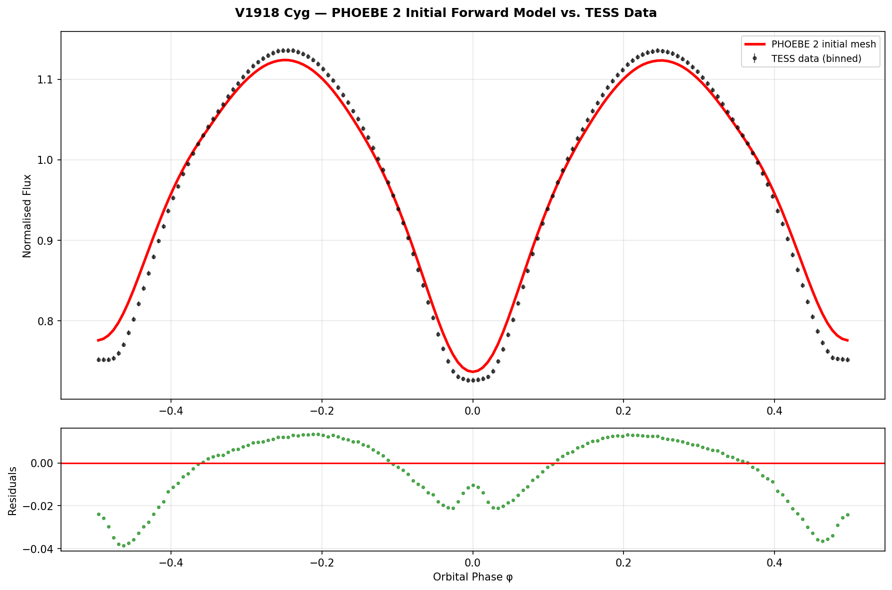
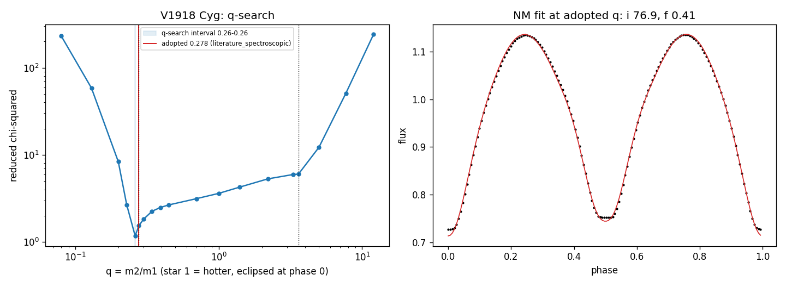
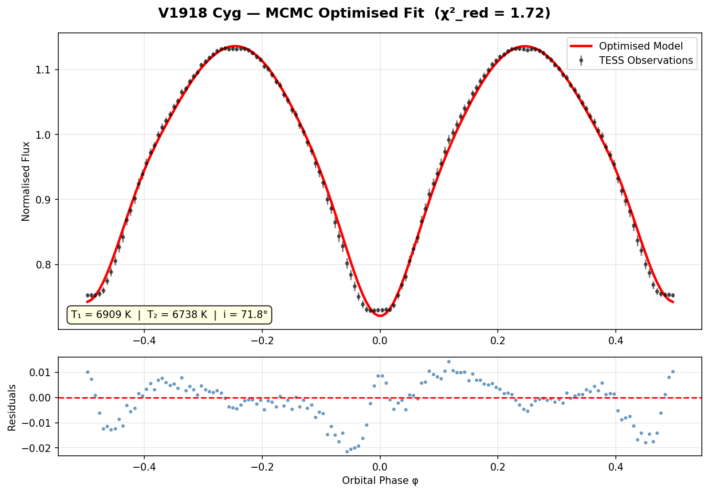
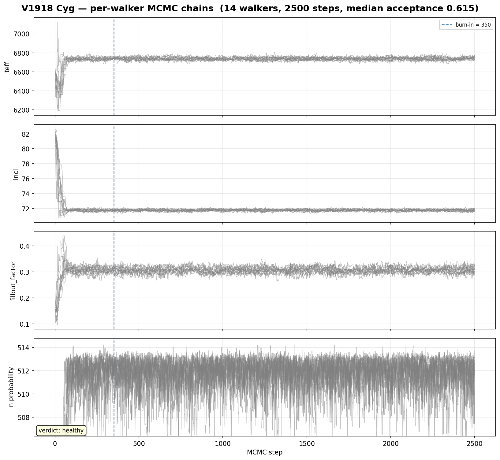
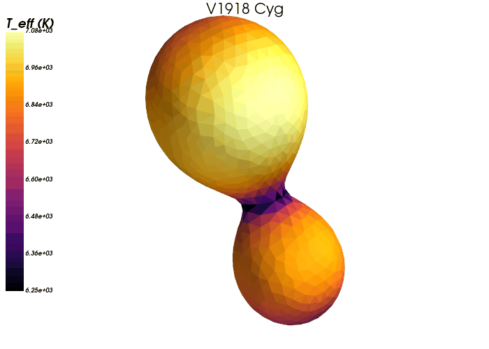

# TESS Binary Modeling Pipeline

An automated, high-precision Python pipeline for the acquisition, reduction, time-series analysis, and thermodynamic modeling of neglected eclipsing binary systems using space-based photometry from the NASA TESS mission.

## Pipeline Architecture

Six sequential stages take raw spacecraft data to physical stellar parameters and rendered geometry. Each stage is a standalone script under `src/` and accepts an optional target-catalogue argument so a single batch can be processed in isolation.

1. **Target Selection (`TargetSelection.py`):** Queries the Kreiner (2004) database and cross-references VSX/GCVS to identify short-period (P < 1 d), long-neglected EW/EB candidates with TESS coverage. Outputs `neglected_targets.csv`.
2. **Data Acquisition (`DataAcquisition.py`):** Retrieves mission-standard PDCSAP light curves (SPOC → TESS-SPOC → QLP fallback, keyed on TIC ID to avoid name-resolution collisions), applies hard bitmasking and 4σ outlier rejection, and validates products by baseline/sector before use (rejecting corrupt partial-FFI stubs). Can stitch multiple sectors when coverage is thin.
3. **O–C Analysis (`OCAnalysis.py`):** Extracts precise barycentric times of minimum via the Kwee–van Woerden algorithm and refines the linear ephemeris against the ~20-year Kreiner baseline. A fold-quality self-check rejects a refined period that folds worse than the catalogue period.
4. **Stellar Modeling (`Modeling.py`):** Builds PHOEBE 2 forward-model bundles with blackbody atmospheres, the contact "double-flip" constraint hierarchy, gravity darkening and reflection by model type (`gravdark.py`), and Gaia DR3 temperature anchoring for the fixed primary.
   - **Contact mass ratio (`ContactQSearch.py`):** for contact systems, q is fixed per star: a published spectroscopic value where one exists, otherwise the minimum of a fixed-q search over the TESS light curve (flagged as weak).
5. **Posterior Optimization (`Optimization.py`):** Solves the inverse problem with a multi-start Nelder–Mead pre-wash followed by the `emcee` affine-invariant MCMC sampler, MPI-parallelised over walkers. Uncertainties are pre-scaled before sampling, the surface mesh is refined for stars whose model is numerically noisy, and early-warning checks park a wrongly set-up star before hours of sampling. Chains are checkpointed and resumable, and posteriors are reported with asymmetric 1σ uncertainties.
6. **Mesh Visualization (`Visualization.py`):** Renders the PHOEBE 2 surface mesh with Mayavi, colour-mapped by per-element effective temperature. Converged systems additionally get an animated GIF spanning one orbital cycle at the refined period, and a contact-sheet montage of the converged sample. Outputs are compared against bundle modification times, so re-running after a batch renders only what changed.

`GenerateThesisTables.py` renders a LaTeX results table from the per-target output. `SchematicRocheGeometry.py` draws generic detached and contact Roche geometries from synthetic parameters, for use as a didactic illustration rather than a result.

## One Star Through the Pipeline: V1918 Cyg

V1918 Cyg is a contact binary (P = 0.413 d) with a published spectroscopic mass ratio of q = 0.278. These are its outputs at each stage.

> **Note.** Panels 1–4 come from the current pipeline. Panels 5–7 come from an earlier run with the mass ratio fixed at a placeholder q = 0.5; they will be replaced when the star finishes its current refit.

**1. Data acquisition.** Raw SAP flux, the PDCSAP flux used downstream, and the folded light curve (TESS sector 75, 200 s cadence).



**2. O–C analysis.** 105 times of minimum from TESS against the Kreiner (2004) ephemeris, and the residuals after the period is refined.



**3. Initial model.** The PHOEBE 2 bundle at its starting parameters against the binned data.



**4. Mass ratio.** Reduced χ² of fixed-q fits across q. The minimum (0.262) lies next to the spectroscopic value (0.278), which is adopted.



**5. Optimized fit** (earlier q = 0.5 run). Data, MCMC model and residuals.



**6. Sampler diagnostics** (earlier q = 0.5 run). Walker traces per parameter.



**7. Surface mesh** (earlier q = 0.5 run). One orbital cycle, coloured by local effective temperature.



## Scientific Context

The project targets "neglected" binaries whose historical ground-based timings have drifted from modern predictions. With single-band photometry the light curve constrains the **fractional** radii (r = R/a), inclination, temperature ratio, and — for contact/total-eclipse systems — a photometric mass ratio; absolute masses and radii require spectroscopic follow-up.

## Repository Layout

```
HOW_TO.md   operating manual for every script
src/        pipeline stages 01–06, the contact mass-ratio search (ContactQSearch),
            the table generator, two schematic utilities, the shared modules
            (paths, runstats, morphology, earlywarn, limbdark, gravdark) and the
            Stage-05 launcher run_05_autorestart.sh and smoke test smoke_05.sh
audits/     standalone diagnostic scripts (period/fold check, time-of-minimum
            estimator, crowding and PDCSAP distortion, results ledger, per-walker
            MCMC chain health, phase alignment, fill-out identifiability; plus
            legacy light-curve / O–C / modeling checks)
docs/       methodology notes, expansion plans and README images (docs/images/)
data/       tominima tables and the sample definition (data/targets/)
tools/      sync_from_working_tree.py — publish-mirror updater
```

Large data products (PHOEBE bundles, FITS light curves) and the private running log are intentionally not tracked here (see `.gitignore`).

## Installation

```bash
pip install phoebe emcee lightkurve numpy scipy matplotlib astropy astroquery mpi4py
```

Stage 06 additionally needs the rendering stack (it renders offscreen, so no display is required):

```bash
pip install mayavi vtk pyqt5 pillow
```

## Execution

**Full operating manual: [HOW_TO.md](HOW_TO.md)** — every script, its arguments,
inputs/outputs, run times, the Stage-05 operating procedure (start / pause / resume,
two queues, recovery after a power cut) and troubleshooting. It uses the working-tree
script names; its section 9 maps them to the names in this repository.

The scripts expect `Targets/` and `data/` in the current directory, so run them from a
working folder (see HOW_TO.md §9.3):

```bash
mkdir run && cd run
cp ../src/*.py ../src/run_05_autorestart.sh . && mkdir -p Audits Targets
cp ../audits/*.py Audits/ && cp ../data/targets/*.csv Targets/

python DataAcquisition.py Targets/neglected_targets_batch1.csv
python OCAnalysis.py      Targets/neglected_targets_batch1.csv
python3 Modeling.py       Targets/neglected_targets_batch1.csv      # Linux / WSL
```

Stage 05 runs under MPI (Linux / WSL) and is resumable: re-running the same command
continues an interrupted chain and skips completed targets. One star uses at most 8
MPI processes (emcee evaluates half of its 14 walkers at a time), so `-n 8` is the
efficient size. The supervised launcher restarts from the last checkpoint if a run
crashes:

```bash
bash run_05_autorestart.sh Targets/neglected_targets_batch1.csv Runs/batch1_05.log "BATCH 1"
# or directly:
mpirun --use-hwthread-cpus -n 8 python3 -u Optimization.py Targets/neglected_targets_batch1.csv
```

Run-size knobs are environment-overridable for smoke tests (defaults are production
values); under `mpirun` they must be forwarded with `-x`. Test on a scratch copy of a
bundle, never on a star with results (HOW_TO.md §6.8):

```bash
export MCMC_NITERS=45 MCMC_CHECKPOINT=15 MCMC_BURNIN=10 NM_MAXITER=20
mpirun -n 8 -x MCMC_NITERS -x MCMC_CHECKPOINT -x MCMC_BURNIN -x NM_MAXITER python3 -u Optimization.py trial.csv
```

Stage 06 (Windows, Mayavi) is safe to re-run after every batch — it renders only stars
whose bundles are newer than their images:

```bash
python Visualization.py Targets/neglected_targets_batch1.csv
```

Pass `FORCE_RERENDER=1` to rebuild every image regardless of modification time.
